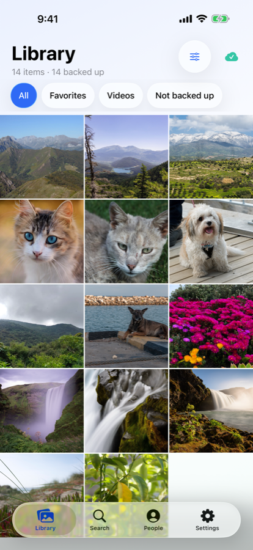
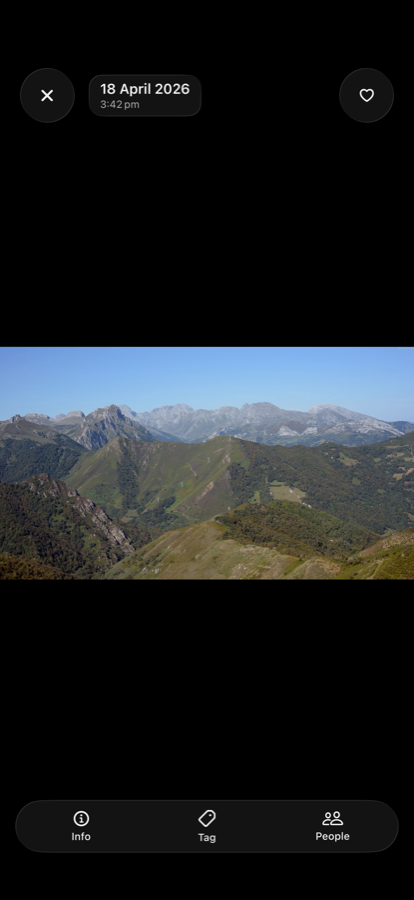
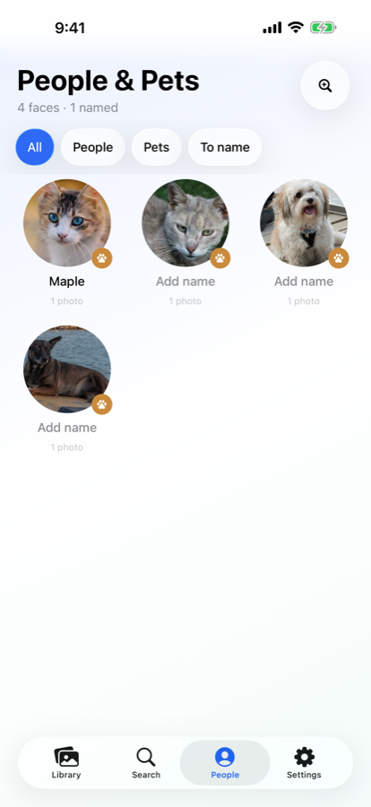
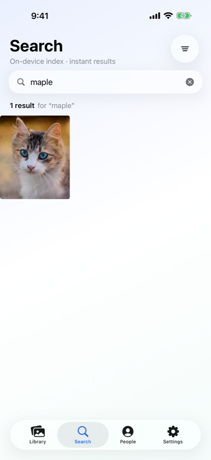
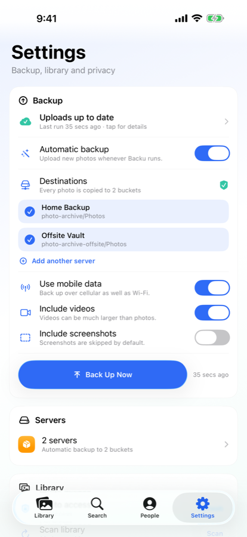
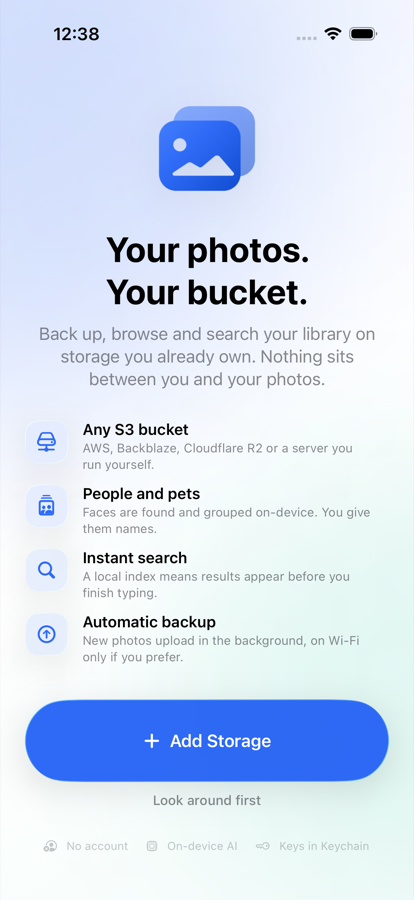

<div align="center">
  

  <h1>Backu</h1>

  <p><strong>Your photos. Your bucket.</strong></p>

  <p>
    <a href="https://github.com/oscartbeaumont/backu/actions/workflows/ci.yml"></a>
    <a href="LICENSE"></a>
    <a href="https://github.com/sponsors/oscartbeaumont"></a>
  </p>
</div>

<br>

Backu is a native iPhone, iPad and Mac app that backs up your photo library to
storage you own. Point it at any S3-compatible bucket and browse, search and
organise a library that feels like Photos — with no account, no subscription and
no server in the middle.

Backu is still being polished for the App Store. Follow along at
[backu.otbeaumont.me](https://backu.otbeaumont.me), or build it from source
below.

<p align="center">
  
  
  
</p>
<p align="center">
  
  
  
</p>

## Why Backu

- **Any bucket you like.** Amazon S3, Backblaze B2, Cloudflare R2, MinIO,
  Wasabi, Synology, or anything else that speaks the S3 API. Choose one
  destination or several; every selected bucket gets its own complete copy of
  every photo, with an optional folder prefix.
- **A library that feels native.** A square grid with month sections, a
  full-screen viewer, favourites, details, and the same app on iPhone, iPad and
  Mac.
- **A real backup, not a sync.** Originals are uploaded unchanged, with a
  SHA-256 of their bytes and a readable JSON sidecar. Videos, Live Photo stills
  and screenshots are included too, and you can turn the last two off.
- **Uploads that survive backgrounding.** Large files keep transferring when
  the app is not in the foreground, and iOS wakes Backu for automatic runs.
  Cellular is opt-in.
- **People and pets, on device.** Vision finds faces and animals, groups them,
  and lets you give each one a name. Face vectors never leave the device.
- **Search without the network.** Search names, tags, places, cameras, lenses,
  years, favourites, videos and which server holds a photo. Every keystroke is
  local.
- **One library across devices.** Open the same bucket on another phone or a Mac
  and photos uploaded elsewhere appear in the grid, with thumbnails fetched on
  demand.
- **Plain files, forever.** Everything Backu knows is stored as readable JSON
  next to the photo. No database, no proprietary format, no lock-in.

## Platform support

| Platform | Requirement |
| --- | --- |
| iPhone and iPad | iOS 26 or later |
| Mac | macOS 26 or later |
| Storage | Any S3-compatible bucket and an access key pair |

## Your files stay yours

Backu writes into the bucket you already own, using a layout you can read
without the app:

```
<folder>/                                   optional prefix; omit for the bucket root
  Photos/2025/06/IMG_4821-d282635d.jpg      original, byte for byte
  Photos/2025/06/IMG_4821-d282635d.jpg.json tags, people, EXIF, GPS and checksum
  .backu/meta/v2/head.json                  pointer to the latest compressed index
  .backu/meta/v2/snap/….jsonl.gz            compressed index snapshot
  .backu/meta/v2/log/<device>/….jsonl.gz    append-only edits from each device
  .backu/atlas/v1/….heic                    tiny thumbnail sheets for fast scrolling
```

The metadata is an append-only log: every device writes only its own segment,
and a periodic compressed snapshot keeps a new device's first sync small.
Nothing rewrites the whole index on an edit, so two phones backing up at once
cannot overwrite each other. Point another S3 client at the bucket, or copy the
folder elsewhere, and the library comes with you.

## Private by design

| Data | Where it lives |
| --- | --- |
| Photo bytes | Your bucket |
| Tags, names, face boxes, EXIF and GPS | Your bucket, in each photo's sidecar and the metadata log |
| Face feature vectors | This device only |
| Access keys | The Keychain |
| Search index | Memory, rebuilt from the local catalog |

There is no Backu account, no analytics, no ads and no tracking. The app talks
straight to the endpoint you enter.

## Getting started

To back up, you need an S3-compatible bucket and an access key pair. Backu has
presets for common providers, opens the right page for creating a key, and tests
the connection — listing the folder, writing a probe object and reading it back
— before saving anything. Keys are kept in the Keychain and only sent to the
endpoint you entered.

## Build from source

Requires Xcode 27 (iOS 27 / macOS 27 SDK, deployment target iOS 26 / macOS 26)
and [XcodeGen](https://github.com/yonaskolb/XcodeGen).

```sh
brew install xcodegen
xcodegen generate
open Backu.xcodeproj
```

Run the `Backu` scheme on an iPhone, iPad or Mac. The tests live in `Tests/`;
the app's S3 integration tests use a local mock bucket, so they never touch your
real storage.

The landing page and App Store privacy/support pages live in `landing/`. See
[`landing/README.md`](landing/README.md) to work on them.

### Releasing

Releases are cut from **Actions → Release → Run workflow**. Choose a
patch/minor/major bump (or enter an explicit version), pick iOS, macOS or both,
and run it. The workflow bumps `MARKETING_VERSION` in `project.yml`, uploads the
TestFlight build, and only after that succeeds pushes the version commit/tag and
publishes a GitHub Release with generated notes. The manual **TestFlight**
workflow remains available for ad-hoc builds.

The repository needs `APPLE_TEAM_ID`, `ASC_KEY_ID`, `ASC_ISSUER_ID` and
`ASC_PRIVATE_KEY`; see [`AppStore/ReleaseChecklist.md`](AppStore/ReleaseChecklist.md).

## Contributing

Contributions are welcome — open an issue, send a pull request, or try the next
build. Bug reports with a reproduction are especially useful. CI builds the app
for iOS and macOS, runs the S3 mock suite, and builds the landing page.

## Support the project

Backu is free, MIT-licensed and has no subscription. If it earns a place in your
workflow, you can support development on
[GitHub Sponsors](https://github.com/sponsors/oscartbeaumont), or from inside
the app under **Settings → Support Backu**. Starring the repo and filing good
issues helps too.

## License

[MIT](LICENSE).

Sample photos in `Tests/Fixtures` are public-domain US government portraits plus
CC BY-SA dog photos; see [`Tests/Fixtures/ATTRIBUTION.md`](Tests/Fixtures/ATTRIBUTION.md).
They are downloaded on demand and are not part of the MIT-licensed source tree.
