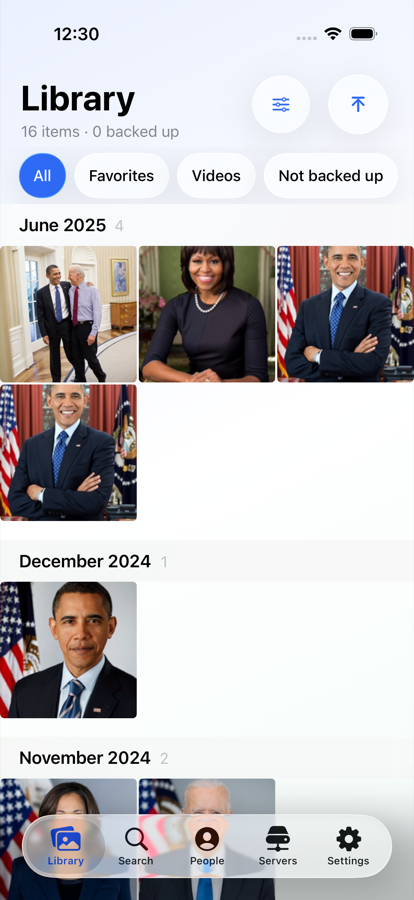
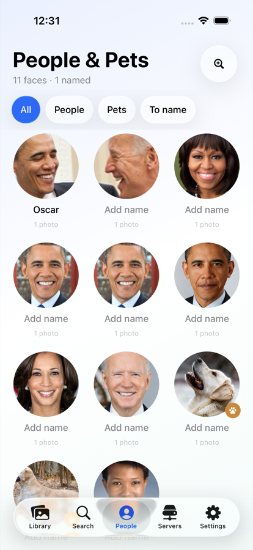
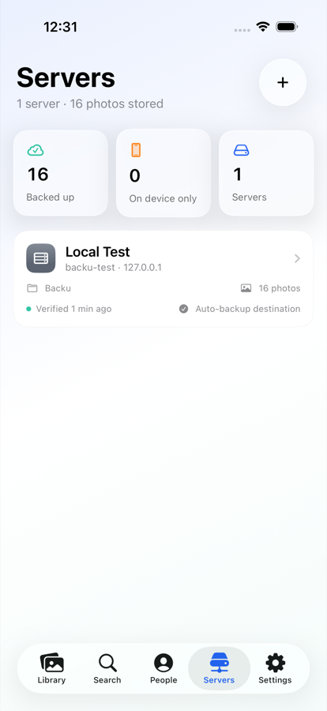

# Backu

[](LICENSE)
[](https://github.com/sponsors/oscartbeaumont)
[](https://github.com/oscartbeaumont/backu/actions/workflows/ci.yml)

**Your photos. Your bucket.**

Backu is a native iPhone, iPad and Mac app that backs your photo library up to any S3-compatible storage, then lets you browse, search and organise it from a library that feels like the Photos app. There is no Backu account and no server in the middle: the app talks straight to the bucket you own.

<p align="center">
  
  
  
</p>
<p align="center">
  
  
  
</p>

## What it does

- **Any S3 bucket.** Amazon S3, Backblaze B2, Cloudflare R2, MinIO, Wasabi, Synology, or anything else that speaks the S3 API. Add as many servers as you like and choose which one automatic backup uses.
- **Photos-style library.** Square grid with month sections, pinch-free zoom levels, a native full-screen viewer with double-tap zoom, favourite, details, and a Liquid Glass chrome layer.
- **Real backup, not a sync.** Originals are uploaded with a stable key layout, a SHA-256 of the bytes, and a readable JSON sidecar. Videos, Live Photos' stills, and screenshots are included (videos/screenshots can be turned off).
- **Fast, stable transfers.** S3 multipart uploads and parallel range downloads, adaptive part sizes and connection counts from the link and measured throughput, exponential backoff with jitter, and a crash journal for interrupted multipart uploads.
- **Background uploads.** Large files go through a background `URLSession` so a backup keeps moving when the app leaves the foreground. A `BGProcessingTask` wakes the app for automatic runs. Cellular is opt-in.
- **People and pets, on-device.** Vision finds faces and animals, feature prints group them into people, and you give each one a name. Biometric vectors never leave the device; names and face boxes sync inside the sidecars.
- **Instant search.** A local index covers names, tags, places, cameras, lenses, years, favourites, videos and which server holds a photo. Keystrokes never touch the network.
- **Multi-device browsing.** Each bucket carries a compact `.backu/index.json`. Open the same bucket on a Mac or another phone and photos uploaded elsewhere appear in the grid, with thumbnails fetched on demand and originals downloaded when you open one.
- **Tags and metadata you can read in 10 years.** Everything is plain JSON next to the photo.

## Storage layout

```
<folder>/
  Photos/2025/06/IMG_4821-d282635d.jpg          original bytes, unchanged
  Photos/2025/06/IMG_4821-d282635d.jpg.json     sidecar: tags, people, faces, EXIF, GPS, SHA-256
  .backu/thumbs/<sha-prefix>.jpg                small previews for other devices
  .backu/index.json                             searchable index + people registry
```

The sidecar is deliberately human-readable:

```json
{
  "schema": "backu.photo.v1",
  "filename": "IMG_4821.JPG",
  "capturedAt": "2025-06-14T10:24:11Z",
  "camera": { "make": "Apple", "model": "iPhone 17 Pro", "iso": 64, "aperture": 1.78 },
  "location": { "latitude": 51.5072, "longitude": -0.1276, "place": "London, England" },
  "tags": ["holiday", "london"],
  "people": [{ "id": "…", "name": "Oscar", "isPet": false }],
  "faces": [{ "x": 0.35, "y": 0.11, "width": 0.29, "height": 0.23, "personID": "…" }],
  "sha256": "…"
}
```

## Transfer performance

The S3 layer is built for real networks, not just localhost:

- Every request goes through **exponential backoff with full jitter** (150 ms base, 10 s cap, 5–7 attempts), honours `Retry-After`, and only retries transient statuses and transport failures. Access-denied and missing-key errors fail immediately.
- Files **over 16 MiB use S3 multipart** with 5–64 MiB parts and 4–10 concurrent streams. Part size and concurrency come from file size, direction, `NWPath` (Wi-Fi/wired/cellular/expensive/constrained), a per-server throughput EWMA, and evidence that the link scales with more connections. Cellular stays at four streams.
- **Downloads over 8 MiB fan out into byte ranges** when the link has meaningful RTT, stream to disk, pin every range with `If-Match`, and `pwrite` each completed range into its slot while the rest are still on the wire. Small objects and fast local links stay on one stream. A 60-second HEAD cache removes a round trip on repeated viewer opens.
- **One streaming SHA-256 pass**, `FileHandle` reads, bounded part payloads and disk staging above a memory budget keep multi-gigabyte videos out of RAM.
- Interrupted multipart uploads are journalled and aborted on the next run. The documented backstop for a lost create response is a bucket lifecycle rule (`AbortIncompleteMultipartUpload`).

Measured with `Tools/Benchmark/run.sh` (1 warm-up + 3 runs, medians). "Shaped" is 60 Mbps **per connection** and 25 ms RTT, modelling a single-stream-limited mobile link; the mock's token bucket is not a shared-bottleneck or packet-loss simulator.

| Scenario | Before (single PUT/GET) | Final |
| --- | ---: | ---: |
| Upload 32 MiB, shaped | 7.0 MB/s | **40.1 MB/s** |
| Upload 128 MiB, shaped | 7.0 MB/s | **66.6 MB/s** |
| Download 32 MiB, shaped | 7.2 MB/s | **56.8 MB/s** |
| Download 128 MiB, shaped | 7.2 MB/s | **70.3 MB/s** |
| Upload 32 MiB, localhost | 397 MB/s | **1346 MB/s** |
| Download 128 MiB, localhost | 4184 MB/s | **6239 MB/s** |

Under 30 % injected 503s the transfer keeps going with bounded retries; one benchmark pass lost an entire download before the longer retry budget and parallel ranges. The one scenario that misses a 15 % step improvement is 32 MiB upload: S3 requires every part except the last to be at least 5 MiB, so 32 MiB can feed at most 6.4 lanes. The details and raw JSON are in [`Tools/Benchmark`](Tools/Benchmark).

## Connecting a provider

S3 buckets are unlocked with an access key pair, not an OAuth login — Amazon, Backblaze and Cloudflare do not offer user OAuth for S3 API access, and an app that pretended otherwise would need a credential broker, which contradicts the "no server in the middle" design. Backu makes the setup as close to one tap as it can honestly be:

- provider presets that fill endpoint, region, addressing style and a sensible folder,
- a **Open** button that deep-links to the exact page where you create a key,
- numbered setup steps in the form,
- **Test Connection**, which really lists the folder, writes a probe object and reads it back before saving.

Then paste the key ID and secret. Keys live in the Keychain (`AfterFirstUnlockThisDeviceOnly`) and are only ever sent to the endpoint you entered.

## Privacy

| Data | Where it lives |
| --- | --- |
| Photo bytes | Your bucket |
| Tags, people names, face boxes, EXIF, GPS | Your bucket, in the photo's sidecar and `index.json` |
| Face feature vectors | This device only (`face-embeddings.bin`, excluded from iCloud backup) |
| Access keys | Keychain |
| Search index | Memory, rebuilt from the local catalog |

## Building

Requires Xcode 27 (iOS 26 / macOS 26 SDK) and [XcodeGen](https://github.com/yonaskolb/XcodeGen).

```sh
brew install xcodegen
xcodegen generate
open Backu.xcodeproj
```

One multiplatform target ships the same SwiftUI code to iPhone, iPad and Mac. On iPhone the root is a tab bar; on iPad and Mac it becomes a `NavigationSplitView`. The Mac build uses the App Sandbox with network client, Photos and user-selected-file entitlements.

Tests:

```sh
# Unit tests (SigV4 vectors, search, sidecar, catalog, Vision, S3 against a local mock)
xcodebuild -project Backu.xcodeproj -scheme Backu \
  -destination 'platform=iOS Simulator,name=iPhone 17 Pro' \
  -only-testing:BackuTests test

# End-to-end UI + real uploads: start the mock bucket first.
python3 Tools/MockS3/mock_s3.py --data-dir /private/tmp/backu-s3 &
xcodebuild -project Backu.xcodeproj -scheme Backu \
  -destination 'platform=iOS Simulator,name=iPhone 17 Pro' \
  -only-testing:BackuUITests test
```

`Tools/MockS3` is a stdlib-only S3 server with a real SigV4 verifier, so the integration tests fail if the signature implementation drifts. `scripts/dev.sh` downloads the public-domain sample photos, sets up a simulator with them, and starts a live mock bucket for hands-on work. The photos are not committed; see `Tests/Fixtures/ATTRIBUTION.md`.

## Testing notes

The UI test suite drives the real app against the mock bucket: it grants Photos access, backs up 16 photos, names a face, verifies the name reaches the sidecar and index in S3, and searches by person and place. Screenshots are attached to the `.xcresult`.

Vision's image feature print is unavailable in the iOS Simulator on some hosts (`Could not create inference context`). Backu retries on the CPU, which makes face detection work everywhere, but in the Simulator the resulting prints are not discriminative. The app detects that and stays in manual-naming mode rather than collapsing every face into one person. On Mac and real devices grouping works.

## Limitations / next

- Grouping quality comes from Vision image feature prints, not a dedicated face-recognition model. Same-session photos group well; a purpose-built embedding model would improve cross-year matching.
- Multipart uploads resume across parts within a run but not across app launches; a crash journal aborts the incomplete upload instead of resuming it.
- Very large files are still limited by S3's 5 GB single-PUT / 10,000-part rules; a bucket lifecycle rule is recommended to clean up uploads whose create response was lost.
- Sidecar edits upload on the next backup pass, which happens automatically after a rename or tag change.
- No album sharing or end-to-end encryption layer yet.

## Repository

```
Sources/Core/S3         SigV4 signer + minimal S3 client (no dependencies)
Sources/Core/Sync       backup engine, background uploader, sidecar/index codecs
Sources/Core/Catalog    catalog, search index, persistence
Sources/Core/Faces      Vision face/pet analysis, embeddings, clustering
Sources/Core/Library    PhotoKit, EXIF, image cache
Sources/UI              SwiftUI screens and the Liquid Glass design system
Tools/MockS3            stdlib S3 mock with SigV4 verification + tests
Tools/Fixtures          deterministic sample library with real EXIF
Tools/Icon              the icon generator (CoreGraphics) and preview sheet
```

The icon is generated, not hand-exported: `swift Tools/Icon/generate-icon.swift` rewrites the asset catalog for iOS, iPadOS and macOS.

## Support the project

Backu is free, MIT-licensed and has no subscription. If it earns a place in
your workflow you can support development on
[GitHub Sponsors](https://github.com/sponsors/oscartbeaumont), or from inside the
app under **Settings → Support Backu**. Starring the repo and filing good issues
helps too.

## Licence

[MIT](LICENSE). The licence text is GitHub's MIT template with the copyright
line filled in; the repository is public and the source is the whole product.

Sample photos in `Tests/Fixtures` are public-domain US government portraits plus
CC BY-SA dog photos; see `Tests/Fixtures/ATTRIBUTION.md`. The fixtures are
downloaded on demand and are not part of the MIT-licensed source tree.
